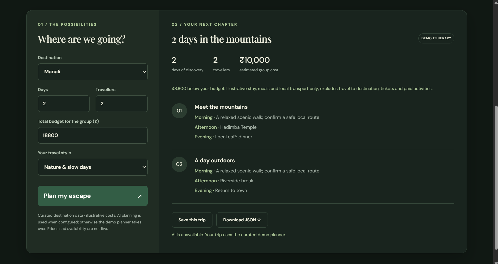
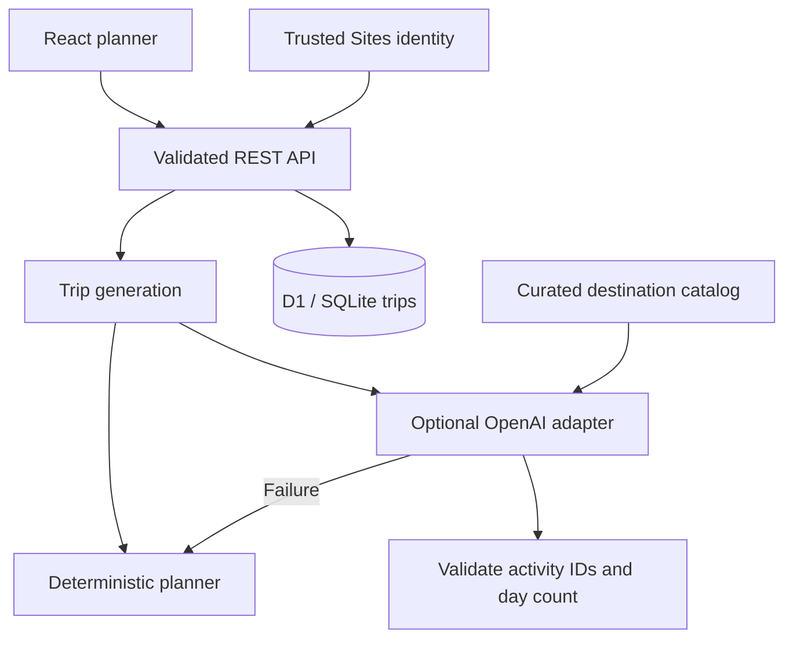

# TripPilot AI

**Plan a short escape. Keep the itinerary. Know how it was generated.**

A full-stack travel-planning portfolio project built with React and TypeScript. Choose Jaipur, Goa or Manali, set a group budget and travel style, then generate a day-by-day itinerary, save it to your account or export it as JSON.

[](https://github.com/aprvydv/trippilot-ai/actions/workflows/ci.yml)

[Quick start](#quick-start) · [Architecture](#architecture) · [API reference](docs/api.md) · [Deployment](docs/deployment.md) · [Project walkthrough](docs/project-walkthrough.md)

> **Current mode: deterministic demo.** The deployed app has `AI_ENABLED=false` and makes no OpenAI requests. The optional server-side AI adapter is implemented and tested with mocked responses; successful live AI generation has not been verified. No API key or paid AI credits are needed for the demo planner or tests.



*Actual application screenshot captured during an earlier provider-fallback test. The “AI is unavailable” message reflects that test; the deployment now intentionally uses demo mode.*

## What you can do

- **Plan a short trip:** three curated destinations, 1–7 days and 1–10 travellers, with balanced, culture or nature preferences.
- **Compare the group budget:** illustrative stay, meal and local-transport estimates, with an over/under-budget summary.
- **Save the displayed itinerary:** a generated draft ID preserves the exact plan without another AI request.
- **Restore your latest saved trip:** account-scoped SQL records, with a legacy browser-storage import when no server trip exists.
- **Export JSON:** download the itinerary for reuse outside the app.
- **See the generation mode:** demo and AI output are labelled explicitly.

The interface uses forest green, sage and ivory, with large typography and a responsive form-and-itinerary layout.

## Engineering decisions

| Decision | Why it matters |
| --- | --- |
| Validate inputs on the server | Browser validation alone cannot protect the API; JSON writes are limited to 8 KiB. |
| Scope SQL queries to the authenticated user | One user cannot list, read or delete another user's trips. |
| Save generated drafts by ID | Clicking Save preserves what the user reviewed and avoids duplicate provider work. |
| Constrain AI output to catalog IDs | The adapter cannot introduce arbitrary activities into a validated itinerary. |
| Compute costs in application code | Estimates follow the same rules in AI and demo modes. |
| Fall back to a labelled demo | Provider failures leave the planner usable without claiming AI success. |
| Test the HTTP handler against SQLite | Integration tests exercise requests, authorization and SQL using the committed migration. |

## Architecture



`POST /api/plan` validates the request, generates a trip and stores a private draft when SQL storage is available. `POST /api/trips` saves that draft. The browser can restore the latest saved record, while the REST API also supports listing, reading and deleting owned trips.

Hosted authentication is supplied by Sites. The Worker trusts identity headers only behind that platform boundary; it is not designed to accept client-supplied identity headers on an independently exposed server.

### Stack

| Layer | Technology |
| --- | --- |
| Interface | React 19, TypeScript, CSS |
| Server and build | Vinext, Vite, Cloudflare Workers |
| Persistence | Cloudflare D1 / SQLite, Drizzle schema and migrations |
| Optional AI | OpenAI Chat Completions with strict structured output |
| Verification | Vitest, Testing Library, Node SQLite, GitHub Actions |

## Quick start

Use **Node.js 22.13+** and npm.

```sh
git clone https://github.com/aprvydv/trippilot-ai.git
cd trippilot-ai
npm ci
npm run typecheck
npm test
npm run build
```

These checks run without an OpenAI API key. To launch the full app, initialize its local database after the first build:

```sh
node --import ./scripts/sites-env.mjs ./node_modules/wrangler/bin/wrangler.js d1 execute DB --local --config dist/server/wrangler.json --persist-to .wrangler/state --file drizzle/0000_lowly_grandmaster.sql
npm run dev
```

Apply the migration only once to a new local database. Open the local URL printed by the dev command. Portable local development uses the retained starter's mock identity; hosted requests use Sites identity. See [deployment instructions](docs/deployment.md) for runtime details and migrations.

### Optional AI

Leave `AI_ENABLED=false` to use the demo. To enable provider requests, configure `AI_ENABLED=true`, `AI_MODEL` and a server-only `OPENAI_API_KEY` in the hosting environment, then redeploy. The default model is `gpt-4o-mini`.

The adapter has a 12-second timeout and validates both the returned day count and every activity ID. It falls back for unavailable providers, refusals, malformed output and unknown activities. API usage requires separate provider billing; a ChatGPT subscription does not fund this API integration.

Never put API keys in source, screenshots, browser variables or Git commits. See [.env.example](.env.example) for configuration names and [deployment configuration](docs/deployment.md) for setup.

## Verification

The latest local check passed **43 tests**, TypeScript checking and the production build. The CI badge above reports the current GitHub workflow result.

Coverage includes planner calculations, UI interactions, HTTP validation, SQL CRUD, owner isolation, exact-draft saving, provider fallbacks and safe error diagnostics. Provider responses are mocked; tests do not incur AI usage charges. The SQL tests use a real SQLite database with a narrow D1 compatibility wrapper.

These checks do not establish live-provider success or replace end-to-end testing of hosted authentication and storage.

## Repository guide

| Path | Responsibility |
| --- | --- |
| `app/` | Page, layout and HTTP route integration |
| `src/` | React UI, deterministic planner, API client and JSON export |
| `server/api.ts` | Validation, request limits and authorization |
| `server/repository.ts` | Parameterized SQL and draft persistence |
| `server/ai.ts` | Provider adapter, output validation and fallback diagnostics |
| `server/catalog.ts` | Versioned activity catalog |
| `db/` and `drizzle/` | Database schema and generated migrations |
| `tests/` | Planner, UI and API/SQL integration tests |
| `.github/workflows/ci.yml` | Automated checks on pushes and pull requests |

## Scope and limitations

- Grounding uses curated project data, not live web research. Destinations are limited to Jaipur, Goa and Manali.
- Costs are illustrative and exclude travel to the destination, admission tickets and paid activities.
- Opening hours, weather, safety conditions and availability are not verified. There is no booking integration.
- The current [hosted deployment](https://trippilot-ai-aprvydv.amberpoppy.chatgpt.site) is owner-private. Reviewers can use the screenshots or run the project locally. Public sharing requires reviewing authentication and abuse controls.
- Demo mode avoids AI API charges; hosting remains subject to the hosting provider's limits.

## Next improvements

These are planned, not implemented:

- A saved-trips list with open and delete actions in the UI.
- Editing a saved trip's inputs and generating a revised itinerary.
- Broader mobile and keyboard-accessibility verification.
- Rate limiting and a public-sharing security review before opening the hosted app to visitors.

## Development transparency

AI coding assistance was used during implementation. The committed source is available for review; credentials, runtime data and generated build output are ignored. The project is presented as an AI-ready planner with a working deterministic demo, not as a verified live travel or booking service.
