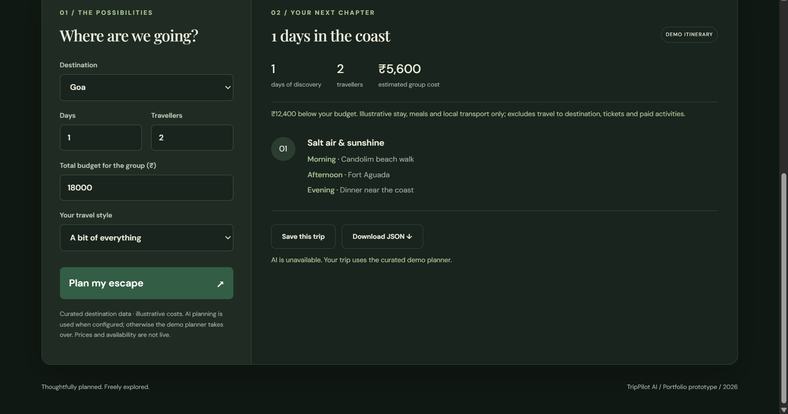

# TripPilot AI — project walkthrough

## Portfolio description

TripPilot AI is a full-stack travel planner built with React, TypeScript and a Cloudflare Worker backend. It turns a destination, group budget and travel preferences into a day-by-day itinerary, with account-scoped SQL storage and JSON export. Its optional OpenAI adapter selects activities from a curated catalog, validates the response and falls back to an explicitly labelled deterministic planner. The current deployment runs in demo mode without paid AI calls.

## A two-minute demonstration

1. Choose **Manali**, **2 days**, **2 travellers**, a group budget of **₹18,800**, and **Nature & slow days**.
2. Select **Plan my escape**. Point out the morning, afternoon and evening schedule and the **Demo itinerary** badge.
3. Explain that the group estimate covers illustrative stays, meals and local transport. It excludes travel to Manali, tickets and paid activities.
4. Select **Save this trip**. Explain that the server saves the existing draft rather than generating a different itinerary.
5. Use **My saved trip** to retrieve the latest saved itinerary for the signed-in account.
6. Select **Download JSON** to show the portable output.

The hosted app is owner-private; use your own signed-in session for the demonstration. A reviewer can follow the README's local setup instructions.

## Application screenshots

### Two-day mountain itinerary

### One-day coastal itinerary

Both screenshots are actual app captures provided during provider-fallback testing. They retain the historical “AI is unavailable” message. The deployment subsequently switched to intentional demo mode with `AI_ENABLED=false`. They are not evidence of successful live AI generation.

## Explain the implementation

| Reviewer question | What to explain |
| --- | --- |
| What happens after submitting the form? | The client calls the REST API; the server validates inputs, generates a trip and stores a private draft. |
| How are trips kept private? | Sites supplies trusted identity. Repository queries bind the owner ID alongside trip IDs. |
| Why store drafts? | Saving should preserve the reviewed itinerary and avoid repeating a provider request. |
| What does the AI actually do? | It arranges allowed activity IDs from the destination catalog. Application code validates them and computes the budget estimate. |
| What happens if AI fails? | The deterministic planner returns a usable result with a truthful demo label. |
| How was it tested? | Planner/UI tests and Request/Response integration tests against real SQLite; mocked provider responses cover success and failure cases. |
| What is unfinished? | Live AI success is unverified, the UI restores only the latest saved trip, and public deployment needs additional review. |

## Evidence to show

- [Automated workflow](https://github.com/aprvydv/trippilot-ai/actions/workflows/ci.yml): type check, tests and production build.
- [API documentation](api.md): routes, validation, ownership and fallback behavior.
- [Deployment documentation](deployment.md): storage setup, identity boundary and server configuration.
- [API integration tests](../tests/api.test.ts): SQL ownership isolation, draft saving and provider diagnostics.

Describe only features you can demonstrate and explain. AI assistance is disclosed in the README; successful live AI generation, verified travel prices and booking support are not claimed.
